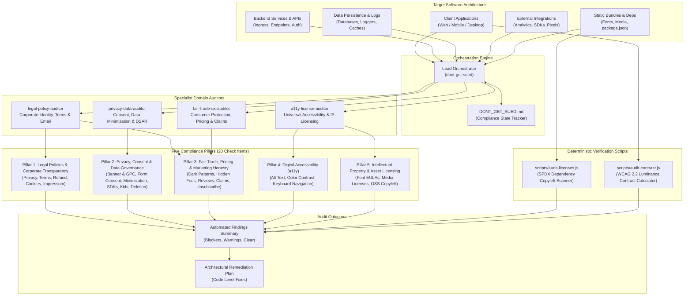

# dont-get-sued — Legal, Privacy, Accessibility & Consumer Protection Auditor

A production-grade Antigravity skill and multi-agent audit suite designed to proactively protect software projects, SaaS products, e-commerce stores, and mobile applications from regulatory fines, consumer lawsuits, and intellectual property liabilities.

Rather than micromanaging file paths or grep patterns, `dont-get-sued` operates at the system architecture level, empowering autonomous agents with comprehensive regulatory criteria, concrete detection heuristics, failure indicators, and deterministic test scripts.

---

## Architecture Overview



---

## The 20 Audited Liabilities

This skill enforces compliance across 20 non-negotiable legal and technical requirements:

| # | Check Item | Statutory Authority | Primary Enforcement Body |
|:---:|:---|:---|:---|
| **01** | **Privacy Policy** | GDPR Art 13/14, CCPA/CPRA, KVKK | EU DPAs, California AG |
| **02** | **Terms of Service (ToS)** | General Contract Law, Restatement (Second) of Contracts | Civil Courts, Arbitration Tribunals |
| **03** | **Refund & Cancellation Policy** | EU Consumer Rights Directive, US ROSCA & California ARL | State AGs, FTC, EU Authorities |
| **04** | **Cookie Policy** | ePrivacy Directive 2002/58/EC | National Telecom Authorities |
| **05** | **Business Details (Impressum)** | EU eCommerce Directive Art 5, DDG Section 5, UK Companies Act | German/EU Courts (Abmahnung) |
| **06** | **Cookie Consent Banner & GPC** | Planet49 (C-673/17), EDPB Guidelines, Global Privacy Control | CNIL, AEPD, California AG |
| **07** | **Check Form Consents** | GDPR Art 7 (Unbundled & Unchecked) | Data Protection Authorities |
| **08** | **No Unnecessary Data (Minimization)** | GDPR Art 5(1)(c), CCPA Section 1798.100 | Regulatory Auditors |
| **09** | **Audit Third-Party SDKs** | GDPR Art 28 (DPA/SCCs), CCPA Sale/Share | FTC (BetterHelp/GoodRx decrees) |
| **10** | **Age Consent for Kids' Data** | COPPA (15 U.S.C. Sections 6501-6506), GDPR-K | FTC (COPPA settlements) |
| **11** | **Data Deletion Request (DSAR)** | GDPR Art 17, CCPA Section 1798.105, App Store 5.1.1(v) | App Store, Play Store, DPAs |
| **12** | **Remove Dark Patterns** | FTC Act Section 5, EU Digital Services Act Art 25 | FTC, European Commission |
| **13** | **Remove Hidden Fees (Dripped Pricing)** | FTC Act Section 5, California Drip Pricing (SB 478 / AB 488) | FTC, State Attorneys General |
| **14** | **Remove Fake Reviews** | FTC 16 CFR Part 465, EU Omnibus Directive | FTC, Competition Bureaus |
| **15** | **Remove Unsupported Claims** | FTC Substantiation Doctrine, EU UCPD | FTC, Advertising Standards |
| **16** | **Email Unsubscribe Link & Address** | CAN-SPAM Act, GDPR, CASL, RFC 8058 One-Click Headers | FTC (Annual inflation-adjusted penalties), ESPs |
| **17** | **Accessibility Alt Text** | ADA Title III, EAA, WCAG 2.2 AA (1.1.1) | US Federal Courts, EU Regulators |
| **18** | **Fix Color Contrast** | WCAG 2.2 AA (1.4.3 & 1.4.11) | Automated ADA Web Crawlers |
| **19** | **Keyboard Navigation & Focus** | WCAG 2.2 AA (2.1.1, 2.1.2, 2.4.7) | ADA Lawsuit Plaintiffs |
| **20** | **License Fonts, Images & OSS** | 17 U.S.C. Section 504 ($150k/work), Copyleft Policies | Copyright Owners, Font Foundries |

---

## Deterministic Verification Scripts

To eliminate LLM hallucination and ensure mathematically sound results, `dont-get-sued` includes standalone verification tools:

- `scripts/audit-licenses.js`: Zero-dependency Node.js script scanning `package.json` and dependency trees for restrictive copyleft licenses (GPL, AGPL, SSPL) vs. approved permissive licenses (MIT, Apache-2.0, BSD, ISC).
- `scripts/audit-contrast.js`: Calculates precise relative luminance and WCAG 2.2 contrast ratios ($L_1 / L_2$) for any foreground/background color pair.

Run directly via CLI:
```bash
node scripts/audit-licenses.js ./package.json
node scripts/audit-contrast.js "#9CA3AF" "#FFFFFF"
```

---

## Autonomous Multi-Agent Architecture

The audit suite deploys a Lead Orchestrator paired with 4 specialist domain auditors:

1. **legal-policy-auditor**: Inspects corporate identity, terms enforceability, statutory cancellation rights, and email marketing compliance (Items 01, 02, 03, 04, 05, 16).
2. **privacy-data-auditor**: Evaluates prior consent gating, Global Privacy Control (GPC) signal handling, form opt-in mechanics, data minimization, telemetry sanitization, COPPA compliance, and DSAR erasure workflows (Items 06, 07, 08, 09, 10, 11).
3. **fair-trade-ux-auditor**: Analyzes user interface affordances, dark pattern prevention, fee transparency, social proof validity, and marketing claim substantiation (Items 12, 13, 14, 15).
4. **a11y-license-auditor**: Audits WCAG 2.2 Level AA accessibility (alt text, contrast, keyboard operability) and intellectual property licenses (fonts, media, open-source packages) (Items 17, 18, 19, 20).

---

## How to Run

### In Antigravity / Agent Chat:
Run the slash command or prompt directly:
```
/dont-get-sued
```
Or ask in natural language:
> "Audit this project for legal liabilities and GDPR compliance using dont-get-sued."  
> "Bu projeyi dont-get-sued kurallarina gore hukuki ve erisilebilirlik acisindan denetle."

### Audit Execution Sequence:
1. The skill initializes `DONT_GET_SUED.md` in the project root (see `examples/DONT_GET_SUED.example.md` for a complete sample output).
2. Specialist auditors evaluate system boundaries, data lifecycles, and interface affordances.
3. Every violation is cataloged with concrete code evidence, statutory grounds, and severity tier.
4. An actionable architectural remediation plan is generated with ready-to-merge code fixes.

---

## Cross-Platform Portability

`dont-get-sued` is designed to be tool-agnostic:

- **Google Antigravity**: Native execution via `SKILL.md` orchestrator and `subagents/` swarm.
- **Claude Code**: Map subagents to `.claude/agents/*.md` with YAML frontmatter, or execute modules sequentially from `modules/`.
- **Cursor / Standalone LLM**: Reference `SKILL.md` as custom workspace rules (`.cursorrules` or `.agent/rules/`).

---

## Repository Structure

```
dont-get-sued/
├── SKILL.md                          # Master orchestration skill
├── README.md                         # Documentation and statutory guide
├── assets/
│   └── DONT_GET_SUED.template.md     # Project compliance matrix template
├── examples/
│   └── DONT_GET_SUED.example.md      # Populated sample audit report
├── scripts/
│   ├── audit-licenses.js             # Deterministic OSS license scanner
│   └── audit-contrast.js             # Deterministic WCAG contrast calculator
├── subagents/
│   ├── legal-policy-auditor.md       # Legal policy & transparency specialist
│   ├── privacy-data-auditor.md       # Privacy engineering & data protection specialist
│   ├── fair-trade-ux-auditor.md      # Consumer protection & ethical UX specialist
│   └── a11y-license-auditor.md       # Accessibility & intellectual property specialist
└── modules/
    ├── 01-legal-policies/            # Modules 01 to 05
    ├── 02-privacy-and-consent/       # Modules 06 to 11
    ├── 03-consumer-protection/       # Modules 12 to 16
    └── 04-accessibility-and-licensing/ # Modules 17 to 20
```

---

## The "Don't Sue Me Either" Disclaimer

> ### **IMPORTANT NOTICE**
> 
> **By using `dont-get-sued`, you formally acknowledge that:**
> 
> 1. **This tool is named `dont-get-sued`, not `i-will-represent-you-in-court-if-you-get-sued`.**
> 2. **I am a software developer, not your corporate attorney, legal counsel, or courtroom bodyguard.**
> 3. **Suing the creator of `dont-get-sued` because you got sued creates a recursive legal paradox that will crash the simulation.**
> 
> **This tool is provided entirely "as is" to catch silly code and UI slip-ups. It comes with zero warranties of any kind. If a regulatory authority or plaintiff knocks on your door, showing them this README will not hold up before a judge. When in doubt, consult a real human lawyer who charges by the hour.**
